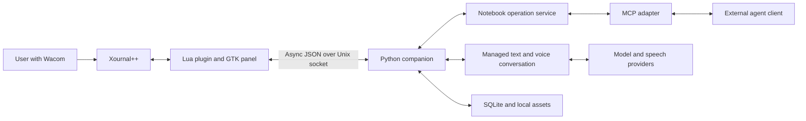
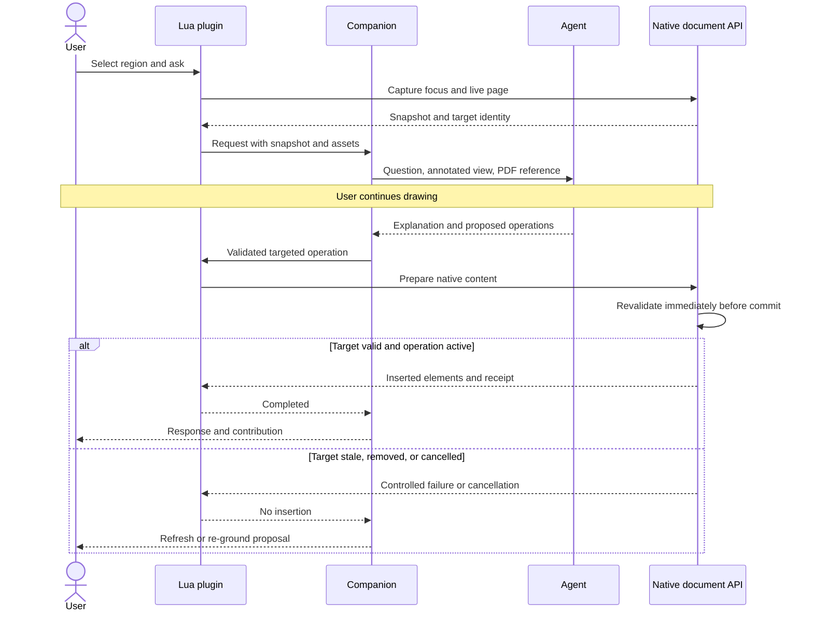
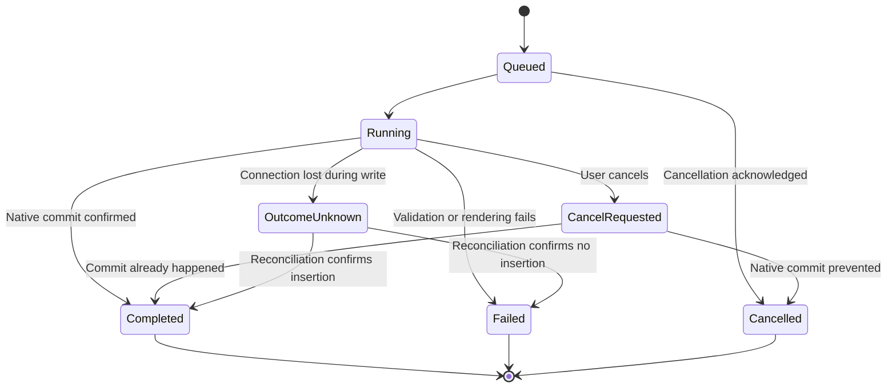
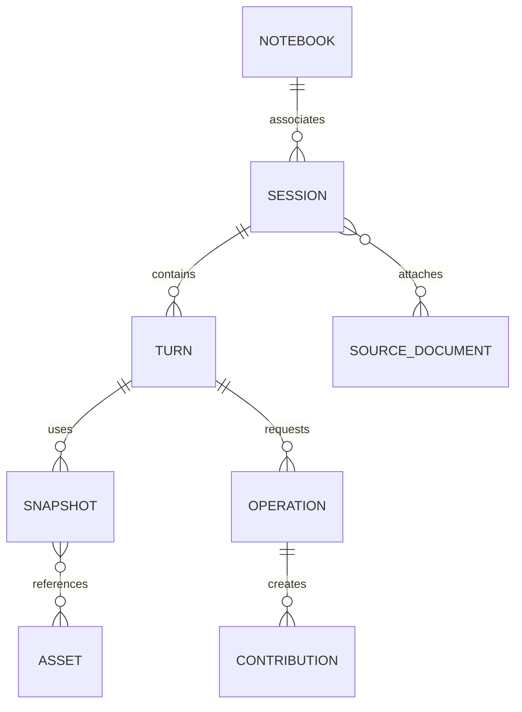
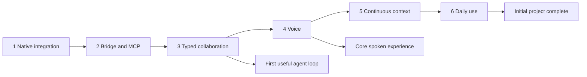

# Xournal++ AI collaboration plan

- Date: 2026-10-26.
- Status: proposed design; implementation begins after the integration checks below.
- Goal: draw, write equations, annotate papers, and discuss that work with an agent that can contribute directly to the notebook.
- Platform: Linux, Wacom tablet, existing Xournal++ workflow.
- Source of truth: this file, reviewed through a draft PR to the user's fork.
- Planning conventions: concise bullets, explicit consequences, small interface examples, and Mermaid diagrams.
- Product emphasis: equal support for mathematics and paper reading through shared notebook tools and adaptable prompts.

## Outcomes and scope

- First useful milestone: select handwriting, ask a typed question, receive an explanation and an editable native equation beside the original work.
- Voice milestone: draw, speak, hear a response, receive a contribution, and continue with the pen.
- Daily-use milestone: resume sessions, follow changing pages and assumptions, recover from failures, and launch without development setup.
- Preserve original ink; agent additions remain ordinary editable notebook elements.
- Use selection or pointing to ground “this term,” “here,” and “what I just changed.”
- Keep model requests, audio, and compilation from interrupting drawing.
- Reuse the original PDF through the selected agent's supported document input.
- => Build collaboration around current visual context and reliable document operations; perfect handwriting transcription is unnecessary.
- Later scope: plots, symbolic computation, richer diagrams, local models, paper libraries, and multiple simultaneous agents.
- => Complete the typed and spoken collaboration loops before introducing specialised subsystems.

## Agreed technology choices

| Component | Proposed choice | Responsibility |
| --- | --- | --- |
| Xournal++ adapter | Lua and lgi | Shortcuts, focus, snapshots, native document operations |
| Native support | Narrow C++ helpers where required | Document identity, stable runtime targets, commit validation |
| Companion | Python 3.13, uv, asyncio | Connections, requests, conversations, assets, persistence |
| Contracts | Pydantic and versioned JSON | Validate requests, results, model tool arguments |
| Local transport | Asynchronous Unix socket | Bidirectional communication between plugin and companion |
| External agents | Official Python MCP SDK, initially stdio | Expose notebook tools to compatible agent clients |
| Interface | Small GTK3 panel through lgi | Record/stop, transcript, responses, proposed contributions |
| Audio | sounddevice; separate transcription and synthesis adapters | Recording, playback, interruption |
| Equations | Native Xournal++ TeX objects and renderer | Source retention and ordinary equation editing |
| Papers | Direct PDF attachment plus fresh annotated images | Research context and current user work |
| Persistence | SQLite and content-addressed asset files | Sessions, snapshots, operation receipts, contribution source |
| Verification | Focused Python/Lua/native checks and tablet trials | Correct targeting, responsiveness, recovery |

- Hosted model and speech services are a working assumption to resolve during provider selection.
- => Keep services replaceable; avoid committing to a provider or prompt architecture before representative trials.
- Existing agent clients and the managed voice conversation share the same notebook operation layer.
- => Conversation history transfers only through supported integrations or an explicit shared context note.

## Upstream baseline and integration checks

- Baseline checked on 2026-10-26:
  - Latest stable release: [1.3.8](https://github.com/xournalpp/xournalpp/releases/tag/v1.3.8).
  - Native Lua TeX insertion: [PR #7711, app.addTexImages](https://github.com/xournalpp/xournalpp/pull/7711), open and targeted at v1.4.0.
  - TeX inspection: [PR #7740, app.getTexImages](https://github.com/xournalpp/xournalpp/pull/7740), listed among open PRs.
  - Existing extension interfaces: [plugin guide](https://xournalpp.github.io/guide/plugins/plugins/) and [Lua API definition](https://github.com/xournalpp/xournalpp/blob/master/plugins/luapi_application.def.lua).
- => Recheck PR status when implementation starts; pin exact commits rather than floating PR branches.
- Prefer integrating native TeX changes and reusing the existing renderer.
- => A separate equation-to-PNG pipeline is not the preferred design.
- Async TeX review discusses page/layer lifetime during compilation.
- => Validate the intended target immediately before native insertion, not only when the request starts.

| Capability to prove | Required evidence | Narrow extension if needed |
| --- | --- | --- |
| Passive selection reads | Bounds and selected content without disrupting tools or selection | Read-only selection operation |
| Live page capture | Unsaved ink and background included; completion and scale known | Export completion hook |
| Native equation insertion | Source, placement, callbacks, failures, undo, save/reopen | Integrate and adjust TeX API |
| Document identity | Open/new/reload/close/Save As distinguished | Document generation ID |
| Page/layer identity | Reorder and deletion handled safely | Opaque runtime handles |
| Final insertion guard | Target still valid, operation not cancelled, freshness checked | Guard at native commit boundary |
| Undo semantics | Actual grouping for each supported batch | Composite transaction only if required |
| Change observation | Available events and polling costs established | Minimal change notification |
| Drawing responsiveness | Native capture/render work measured | Bounded async native helper |

## Architecture



- Lua plugin:
  - Register application actions and configurable shortcuts.
  - Capture focus, selection, document metadata, and exported images.
  - Apply supported operations through Xournal++ APIs.
  - Report capabilities, progress, results, and document changes.
- Native helpers:
  - Follow the pinned project's UI-thread, locking, and lifetime conventions.
  - Add only identities, passive reads, observation, or commit behaviour unavailable through Lua.
  - Keep helpers useful independently of AI.
- Companion:
  - Route connected windows; validate schemas; serialise writes.
  - Own model/speech calls, source attachments, assets, receipts, diagnostics, and persistence.
  - Remain usable when an individual provider request fails.
- MCP adapter:
  - Connect to the existing companion instead of starting duplicate state stores.
  - Convert local assets into image/document representations supported by the host.
  - Keep stdout reserved for MCP messages.
- Managed conversation:
  - Capture context, call a model, execute bounded validated tools, return results, and speak.
  - Reuse the operation service rather than creating a second write path.
- GTK panel:
  - Start as a floating native window; consider docking after real use.
  - Keep technical diagnostics out of normal interaction.

### Critical plugin entry point

- Proposed shortcut registration; actual binding remains configurable.
- Capture and transport work must continue asynchronously after the callback.

```lua
function initUi()
  app.registerUi({
    menu = "Ask agent",
    callback = "askAgent",
    accelerator = "<Control><Alt>a",
  })
end
```

## User workflows

| Workflow | Context | Expected contribution |
| --- | --- | --- |
| Check a derivation | Selected step, surrounding handwriting, current assumptions | Explanation and corrected native equation |
| Explain a paper | Original PDF, mapped source page, annotated region | Answer with page/figure reference and optional margin note |
| Develop an illustration | User sketch and spoken intent | Label, arrow, simple native strokes, or retained-source asset |
| Revise an assumption | New instruction and fresh snapshot | Updated reasoning and explicit contribution proposal |
| Resume research | Saved conversation, confirmed assumptions, reopened notebook | New snapshot and re-grounded references |

- Explicit insertion requests can act directly at the selected target.
- Incidental suggestions remain proposals until the user chooses to insert them.
- More automatic additive contributions are a session preference established through trials.
- => Avoid a mandatory confirmation for every read or routine requested insertion.
- Ambiguous handwriting or reference: ask one focused grounding question.
- Changes to existing user work require a specific current target; begin with additive operations.

## Document identity and coordinates

- Separate:
  - Plugin/window connection identity.
  - Open document generation, invalidated by replacement/reload.
  - Saved notebook association used for session recovery.
  - Runtime page/layer handles.
  - Current page/layer indexes used for display and navigation.
- Page indexes change after reordering; duplicate pages can have identical content.
- => Indexes and content hashes cannot substitute for identity.
- Runtime handles expire across restarts; native pointer strings never become public persistent IDs.
- Reassociate reopened notebooks using paths and file evidence; ask for a fresh target when page identity is ambiguous.
- Save As and externally copied files need an explicit association policy.
- Unsaved notebooks retain temporary associations until saved.
- Coordinates:
  - Page points; top-left origin; x rightward; y downward.
  - Every image includes pixel dimensions, crop offset, and a transform to page coordinates.
  - Keep source PDF page, notebook page index, pixel position, and page-point position distinct.
  - Validate finite values, bounds, margins, and readable object dimensions.
- => Zoom and crop changes cannot silently change where an annotation lands.

## Context capture and request flow

- At each user turn:
  - Capture selection or explicit focus.
  - Obtain a detailed region image and enough whole-page context.
  - Include native text/TeX source when useful and supported.
  - Include PDF association and source-page mapping.
- Handwriting and diagrams remain visually authoritative.
- => Native metadata supplements images; full-document stroke extraction is unnecessary for ordinary turns.
- For speech, record focus at recording start/end and deliberate pointing changes during the utterance.
- Initial observation: explicit turn snapshots and checks before writes.
- Later observation: coalesced relevant change events or conservative dirty checks.
- => Do not repeatedly export the whole notebook while the user draws.



- Suggestions remain tied to their original snapshot; navigation does not retarget them.
- Relevant user edits trigger refresh or hold the insertion.
- Initially reject conservatively when the target page changed; allow unrelated edits only after reliable regional checks.
- => A late response cannot overwrite a revised derivation or appear in another notebook.


## Notebook operation interface

- Names below belong to the extension; map them onto proven native APIs.

| Operation | Result/effect | Phase |
| --- | --- | --- |
| get_capabilities | Build, protocol version, supported native features | 1 |
| list_documents | Connected windows and document identities | 2 |
| get_context | Focus, structure, page mapping, snapshot metadata | 2 |
| capture_region | Annotated region image and coordinate transform | 2 |
| capture_page | Annotated page image and snapshot metadata | 2 |
| insert_text | Bounded native text on an explicit target | 2 |
| insert_equations | Batch of native TeX objects | 2 |
| insert_strokes | Supported simple native strokes | 2 |
| get_operation | Progress, receipt, error, or uncertain outcome | 2 |
| get_source_document | Original PDF reference, digest, source-page mapping | 3 |

- Add contribution replacement only after reliable element targeting exists.
- Keep broad deletion and arbitrary notebook rewriting outside the initial tool surface.
- Each mutation carries an operation ID, explicit target, source snapshot, and typed parameters.
- Validate model output before passing it into the plugin.
- Use bounded newline-delimited JSON, request IDs, notifications, and a version/capability handshake.
- Store large local assets separately; adapters provide the representation their clients require.

### Critical request contract

```json
{
  "protocol_version": 1,
  "request_id": "request_example",
  "operation_id": "operation_example",
  "method": "insert_equations",
  "target": {
    "connection_id": "connection_example",
    "document_generation": "document_example",
    "page_handle": "page_example",
    "layer_handle": "layer_example"
  },
  "based_on_snapshot": "snapshot_example",
  "params": {
    "equations": [
      {
        "source": "E = mc^2",
        "position_pt": {"x": 72, "y": 180},
        "max_width_pt": 220
      }
    ]
  }
}
```

- Final fields follow phase-one capability tests.
- => Implement declared placement/size behaviour in the adapter or return an unsupported-parameter error.
- Error classes: invalid arguments, incompatible protocol, unsupported capability, missing target, stale context, compilation failure, provider failure, disconnection, uncertain outcome.
- Acceptance acknowledges a request; completion confirms native insertion.
- => Never report an equation as inserted merely because it was queued.

### Operation lifecycle



- Retry with the same operation ID; keep a live plugin ledger and persisted companion receipts.
- Reconcile before retrying a write after reconnect.
- Xournal++ and SQLite do not share a transaction.
- => If the application dies around a write and the result cannot be established, retain outcome_unknown and avoid automatic replay.
- Serialise document writes; allow concurrent reads where supported.
- One conversation owns write access to a document in the prototype.
- => Multiple clients cannot race to apply incompatible contributions.

## Native equations and contribution behaviour

- Each contribution records:
  - Originating turn, operation ID, source snapshot.
  - Authoring conversation and placement.
  - Retained equation/diagram source.
  - Runtime native references while valid.
  - Native receipt and current document presence when inspected.
- Keep visible elements in Xournal++; supplementary history belongs in the companion.
- => Notebooks remain usable without the extension.
- Use an identifiable agent contribution layer on each page.
- Respect selection, active tool, and focus when changing target context.
- Render with Xournal++'s configured TeX environment.
- Detect missing dependencies and surface actionable native errors.
- Keep generated content within supported template/compiler constraints.

### Critical insertion boundary

- Proposed native-side pseudocode; implement using the pinned project's lifetime and locking conventions.
- A Lua callback after insertion cannot enforce these checks.

```cpp
void commitPreparedContribution(const Operation& op, PreparedContent content) {
    auto target = resolveLiveTarget(op.target);
    require(target.documentGeneration == op.documentGeneration);
    require(target.pageExists && target.layerExists);
    require(!isCancellationAcknowledged(op.id));
    require(isSnapshotApplicable(op.snapshot, target));
    insertUsingNativeUndo(target, std::move(content));
    recordNativeReceipt(op.id, target);
}
```

- Cancellation and commit must resolve through the same native boundary.
- => Cancelled means insertion was prevented; an already committed operation returns its receipt and remains undoable.
- Compile completion can outlive the original request.
- => A wrapper timeout cannot be treated as proof that insertion was prevented.
- Placement:
  - Prefer an explicit selected destination.
  - Otherwise compute a bounded candidate beside/below the referenced region.
  - Preview or request another location when no readable space exists.
  - Preserve ordinary move/resize tools.
- Undo:
  - Verify grouping for each supported native batch.
  - Document mixed-contribution behaviour honestly; a note and diagram may require separate undo actions.
  - Add a native composite transaction only when needed.
- Replacement:
  - Re-read current source and element identity.
  - Hold if the user changed it after the proposal.
  - Never replay an old replacement after reload or reconnect.

## Papers

- Supply the original PDF through the backend's supported document interface.
- Attach a fresh annotated page/region for handwriting, highlights, and unsaved changes.
- Track PDF content digest, local source, backend reference, validity, and notebook-to-source page mapping.
- Inserted blank notebook pages and repeated PDF pages must preserve correct source mapping.
- Reuse valid attachments; refresh expired references.
- => Reuse reduces transfer, but does not promise free document processing or token usage.
- For external MCP clients, verify actual document delivery.
- => Returning a local path or resource URI does not prove the model received the PDF.
- When a document exceeds backend limits, use its supported page/document selection path.
- Add extraction or retrieval only after repeated real cases establish a need.
- Reference: [PDF input example](https://ai.google.dev/gemini-api/docs/document-processing).

## Agents and conversation ownership

- External mode:
  - Host owns conversation/model calls.
  - MCP adapter supplies notebook operations and supported resources.
  - Companion retains operation history without assuming access to the host's entire transcript.
- Managed mode:
  - Companion owns text/voice transcript, context assembly, model calls, bounded tool loop, and speech.
  - Persist the conversation and refresh notebook context before resuming writes.
- Switching modes:
  - Share explicit definitions, assumptions, and unresolved questions through a context note.
  - Import more history only through a supported integration.
- => Shared notebook tools do not imply automatic cross-client conversation continuity.
- Agent guidance:
  - Ground references in supplied regions.
  - Clarify ambiguous symbols.
  - Keep speech concise; put substantial derivations in visible text/equations.
  - Identify source pages/figures when discussing papers.
  - Treat later calculation-tool results as explicit evidence.
- Provider selection:
  - Trial one or two candidates on real handwriting, diagrams, and papers.
  - Compare task quality, PDF/image support, tool behaviour, latency, and cost.
  - Record evaluated model/SDK versions.
  - Select speech services independently when useful.
  - Keep adapters narrow; expand abstractions when another implementation needs them.
- Reference: [MCP Python SDK](https://github.com/modelcontextprotocol/python-sdk).

## Voice and GTK interface

- Start with record/stop toggle and an application shortcut.
- Add hold-to-talk only after validating key-release and focus handling.
- Permit existing tablet-button mapping to trigger the same action.
- Pipeline: capture speech => transcribe => assemble current visual context => reason/tools => display response => synthesise/play speech.
- Use separate stages initially for inspectable transcripts and flexible visual reasoning.
- Capture a current snapshot when recording ends; include deliberate focus changes during speech.
- Show recognised text; allow correction or cancellation.
- Speak readable mathematical language rather than raw TeX.
- Keep full response text available.
- Stop local playback immediately; discard queued audio on Stop.
- Cancelling a turn also fences future document commits.
- => Remote providers may finish after cancellation, but late results cannot silently mutate the notebook.
- GTK panel:
  - Recording indicator, editable transcript, recent response.
  - Focus indicator and notebook connection state.
  - Proposed contributions with Insert/Dismiss where relevant.
  - Stop and Cancel controls.
  - Keyboard navigation, desktop scaling, tablet-friendly controls.
- Keep notebook pen focus unless the user intentionally interacts with the panel.
- Streaming transcription or unified speech services follow measured improvements.
- Reference: [sounddevice](https://python-sounddevice.readthedocs.io/en/latest/).

## Persistence and recovery



| Record | Essential fields |
| --- | --- |
| Notebook | Generated association ID, known paths, saved-file evidence |
| Session | Notebook, agent mode, provider configuration, timestamps |
| Turn | Transcript/question, response, status, snapshots |
| Snapshot | Runtime target, time, region, transforms, fingerprints, image assets |
| Source document | PDF digest/location, backend reference, validity, page mapping |
| Operation | ID, target, parameters digest, lifecycle, native receipt/error |
| Contribution | Source, placement, turn, native references while valid, receipt |
| Context note | Definitions, assumptions, unresolved questions, corrections |

- SQLite schema migrations from the first persisted version.
- Content-addressed files for binary assets; bounded caches.
- XDG configuration/data/state paths; socket in the user runtime directory.
- Keep original PDFs referenced in place where practical.
- Raw audio temporary by default; retain transcripts, assumptions, sources, and receipts.
- Provide session export/deletion and asset cleanup.
- On companion restart: reconnect live plugins and reconcile operation IDs.
- On application restart: expire runtime targets and pending write authority.
- Resume against a fresh snapshot; re-ground ambiguous references.
- => Reconnection is not authorisation to replay pending writes.
- History records prior application; the live document determines whether a contribution still exists after edits or undo.


## Implementation phases



### Phase 1 Prove native integration

- Goal: establish usable native reads, equation insertion, target identity, and responsiveness.
- [ ] Record Linux distribution/session, Xournal++ installation/version, tablet configuration, and TeX setup.
- [ ] Build a separate development checkout; preserve the ordinary installed application.
- [ ] Recheck/integrate TeX PR changes; pin base, patch commits, dependencies, and build options.
- [ ] Implement diagnostic Lua actions: capabilities, selection capture, page export, text insertion, equation insertion.
- [ ] Test selection side effects, open/new/reload/Save As, duplicate/reordered pages, and removed layers.
- [ ] Test navigation, document replacement, page deletion, and cancellation during compilation.
- [ ] Add minimal runtime identity and native commit guards where needed.
- [ ] Verify native edit, undo/redo, save/reopen, and export.
- Deliverables: reproducible build instructions, capability matrix, diagnostic plugin, disposable notebooks, narrow patch set.
- Exit: an editable equation survives save/reopen; invalidated targets fail cleanly; the pen remains usable during rendering.
- => Resolve unsafe native insertion before advertising writes; read-only bridge work can proceed independently.

### Phase 2 Build the bridge and MCP tools

- Goal: reliable local document operations shared by all agent modes.
- [ ] Create Python package, uv lockfile, configuration, and versioned schemas.
- [ ] Implement asynchronous socket handshake, routing, progress, response correlation, and managed assets.
- [ ] Implement snapshots, transforms, passive focus reads, page/region capture, and native insertion adapters.
- [ ] Add write queue, operation IDs, receipts, duplicate suppression, cancellation, and reconnect reconciliation.
- [ ] Expose initial MCP tools; verify image results in one client.
- [ ] Add diagnostic CLI and synthetic plugin fixtures.
- [ ] Test malformed requests, unsupported features, delays, disconnects, and duplicate writes.
- Deliverables: companion package, Lua bridge, protocol reference, MCP configuration, focused integration checks.
- Exit: a client reads a selected region and inserts text/equations/strokes without blocking drawing; duplicates reconcile and uncertain outcomes remain explicit.

### Phase 3 Establish useful typed collaboration

- Goal: multi-turn mathematics and paper reading without manual screenshot/equation transfer.
- [ ] Prepare representative handwriting, diagram, annotated-paper, and ambiguous-reference cases.
- [ ] Verify one external agent client's image, PDF, MCP, cancellation, and reconnect behaviour.
- [ ] Evaluate one or two candidate models for any managed provider; record quality, latency, cost, versions.
- [ ] Implement source PDF references and correct notebook/source-page mapping.
- [ ] Implement context assembly, bounded validated tool calls, responses, and contribution provenance.
- [ ] Trial insertion requests, proposal previews, placement, stale snapshots, and actual undo behaviour.
- [ ] Add the minimal managed text conversation needed for voice.
- [ ] Refine prompts from observed errors; keep research/maths on shared tools.
- Deliverables: typed loop, documented client integration, managed text path, example transcripts, evaluation notes.
- Exit: select derivation => ask => receive explanation/equation => revise assumption => continue using fresh context; paper questions reach the correct original PDF.

### Phase 4 Add voice

- Goal: complete the same loop while the user keeps the pen in hand.
- [ ] Add audio device selection, recording/playback, and actionable device errors.
- [ ] Add record/stop shortcut and tablet-button mapping instructions.
- [ ] Integrate transcription and synthesis adapters.
- [ ] Build GTK panel with transcript correction, response view, recording/focus status.
- [ ] Implement Stop, turn cancellation, audio queue cancellation, and cancellation/commit race handling.
- [ ] Measure capture, transcription, model, tool, compile, and playback latency separately.
- [ ] Trial mathematical vocabulary, focus changes during speech, navigation, and interruptions.
- Deliverables: spoken loop, visible transcript, interruption controls, device configuration, timing measurements.
- Exit: draw => speak => hear response => receive equation => continue; cancelled operations cannot later insert; typed input remains available.

### Phase 5 Follow evolving context

- Goal: continuous reference across changing handwriting, pages, and sessions.
- [ ] Add relevant change notifications or conservative coalesced dirty checks.
- [ ] Track navigation, selection, user edits, and contributions without full-document polling.
- [ ] Refresh context before dependent reasoning/writes; handle references to earlier contributions.
- [ ] Add pointing only if ordinary selection is insufficient.
- [ ] Persist and expose corrections to definitions, assumptions, and unresolved questions.
- [ ] Implement notebook reassociation and session resume with expired runtime handles.
- [ ] Add targeted replacement after current element identity and user edits can be respected.
- [ ] Improve context selection/summarisation from session measurements.
- Deliverables: grounded refresh, session continuity, controlled updates, context-selection diagnostics.
- Exit: several turns/pages and reopen/resume work correctly; changed assumptions propagate; observation does not noticeably affect drawing.

### Phase 6 Prepare daily use

- Goal: dependable installation, launch, recovery, and repeated use.
- [ ] Package plugin/companion and document required native build.
- [ ] Add doctor checks for native capabilities, Lua/lgi, TeX, audio, socket, and agent configuration.
- [ ] Document start/stop/reconnect, logs, export, cleanup, upgrade, and rollback.
- [ ] Refine placement, layers, shortcuts, and panel ergonomics through actual sessions.
- [ ] Test long sessions, large papers, outages, restarts, cache limits, and two windows.
- [ ] Maintain compatibility records and update procedure for upstream API changes.
- [ ] Prioritise later tools based on demonstrated user needs.
- Deliverables: daily-use release, operations guide, compatibility record, follow-up backlog.
- Exit: open a notebook/paper and work without development commands; provider/companion failure leaves ordinary Xournal++ use available.

## Verification

### Focused automated checks

| Area | Required cases |
| --- | --- |
| Protocol | Version mismatch, malformed/oversized messages, capabilities, response IDs |
| Coordinates | Crops, transforms, zoom-independent placement, page bounds |
| Identity | Reload, duplicate/reordered/deleted pages, deleted layers, expired handles |
| Writes | Duplicate IDs, serialisation, late results, cancellation races, uncertain receipts |
| Persistence | Migrations, reconnection, notebook association, asset cleanup |
| Agents | Correct context/turn, bounded tool loops, ambiguous references, provider failures |
| Papers | Correct PDF page, blank notebook pages, reused/expired/missing attachments |
| Voice | Record/stop, playback interruption, device loss, cancellation propagation |

- Fake plugin tests provide deterministic protocol/lifecycle coverage.
- => Native object lifetime, selection behaviour, undo, and responsiveness still require real application checks.
- Use native debug/sanitiser builds for lifetime failures where the pinned build supports them.
- Build and test without model credentials through synthetic or recorded adapters.
- Do not run broad suites for minor reversible UI/documentation changes; run relevant checks.

### Real application acceptance suite

- [ ] Insert/edit equation; undo/redo; save/reopen; export.
- [ ] Navigate while rendering; insertion stays attached to its original valid target.
- [ ] Delete target page/layer during rendering; controlled result, no stray insertion.
- [ ] Replace/reload notebook during request; old write authority expires.
- [ ] Edit referenced handwriting while agent thinks; refresh or hold insertion.
- [ ] Send same operation twice; no duplicate completed contribution.
- [ ] Disconnect around commit; reconcile or retain honest uncertainty.
- [ ] Read a handwriting selection; preserve focus, selected work, and tool usability.
- [ ] Insert blank notebook page; preserve correct source PDF mapping.
- [ ] Cancel during compilation; verify native cancellation/commit ordering.
- [ ] Use two windows; verify explicit document routing.
- [ ] Restart companion and Xournal++ separately; verify recovery without replay.

### User trials and evidence

- Trial a derivation, a paper-reading session, and a diagram discussion.
- Record keyboard/context switches, repeated explanations, grounding mistakes, annotation moves, and unexplained waiting.
- Separate model reasoning failures from integration failures.
- => Wrong mathematics needs evaluation; wrong-page insertion needs an integration fix.
- Each phase records tested commits/configuration, demonstrated flows, failing cases, and next changes.
- Exit gates require demonstrated behaviour, not only mocks or scaffolding.

## Performance and operating constraints

- Initial targets, to measure on the user's machine:
  - Status feedback within 250 ms.
  - Local speech Stop within 300 ms under normal device operation.
  - Typical page/region capture around one second or less, without a long UI stall.
  - No noticeable lost pen input during provider/TeX work.
  - Bounded assets and low idle activity.
- Measure typical and slow-case capture, upload, transcription, model, tools, compile, and playback times.
- Optimise the largest measured delay; reuse valid documents/assets and coalesce notifications.
- => An out-of-process model does not eliminate native capture/render costs.
- Show the active stage and allow cancellation before more aggressive streaming.

## Local access and data handling

- User-owned runtime socket with restrictive filesystem permissions; no remote listener initially.
- Limit tools to selected notebooks and registered sources.
- Resolve model asset IDs through the managed store; do not expose arbitrary shell or file-path tools.
- Treat instructions inside papers as source content rather than authority to run operations.
- Keep credentials out of notebooks, session exports, and diagnostics.
- Show active backend/context; configure hosted processing before real-paper trials.
- Verify native TeX template/compiler settings, resource limits, and available subprocess confinement.
- => Disabling shell execution alone does not establish complete file isolation.
- Use synthetic or user-approved material for shared fixtures; provide redacted diagnostics.


## Risks and decisions

| Risk/gap | Consequence | Response |
| --- | --- | --- |
| TeX PRs unmerged or conflicting | Maintained development build needed | Pin commits and keep local patches narrow |
| Missing native final guard | Invalid late insertion | Resolve in phase 1 |
| Index/hash mistaken for identity | Wrong document/page targeting | Generation IDs and runtime handles |
| Context reads disturb selection | Tablet workflow interrupted | Passive reads or narrow helper |
| PDF resource unsupported by host | Agent never sees paper | End-to-end attachment trial |
| Ambiguous handwriting/reference | Wrong premise | Better crop and focused grounding question |
| Failure around commit | Document and receipt disagree | Reconcile; no automatic uncertain replay |
| User edits/undo invalidate history | Stale replacement | Re-read live document |
| Speech vocabulary/latency | Repeated corrections/waiting | Editable transcript, stage timings, Stop |
| Context costs grow | Expensive sessions | Usage records, attachment reuse, bounded context |
| Optional features expand scope | Core loop delayed | Complete typed and voice milestones first |

| Decision | Default/checkpoint |
| --- | --- |
| Distribution/session/TeX setup | Establish at start of phase 1 |
| Native base and helper scope | Resolve from phase 1 evidence |
| External client and managed model | Representative phase 3 trials |
| Speech providers and shortcuts | Phase 4 |
| Automatic contribution preference | Explicit insertion initially; trial in phase 3 |
| Pointing beyond selection | Add in phase 5 if needed |
| Distribution format | Development install, then phase 6 packaging |
| Plots/calculations/local inference | Later, based on actual use |

## Repository and review workflow

- Proposed implementation layout:

```text
plugin/                    # Lua integration and GTK panel
src/xournalpp_ai/           # Companion, protocol, tools, agents, audio, state
native/                    # Pinned upstream commits and narrow patches
tests/                     # Focused protocol/native integration fixtures
scripts/                   # Development setup and diagnostic helpers
docs/ai-collaboration-plan.md
docs/development.md
docs/operations.md
```

- Keep the layout minimal until responsibilities need separate modules.
- Use uv lockfile and native upstream lock record for reproducibility.
- Document actual changes, focused verification, and remaining tablet trials.
- Prefer worktrees; do not develop off the default checkout.
- Initial delivery requested by the user:
  - Save this FULL plan to `~/.agents/plans/<UTC datetime>_xournalpp-ai-collaboration.md`, using `date -u '+%Y-%m-%dT%H-%M-%S'`.
  - Verify GitHub account; local CLI currently identifies `torfjelde`.
  - Clone `xournalpp/xournalpp` to `/drive-2/Projects/mine/xournalpp`.
  - Read applicable repository instructions and contribution/documentation conventions.
  - Create or reuse the user's fork; preserve existing fork work.
  - Configure upstream and fork remotes.
  - Verify upstream default branch; current source uses `master`.
  - => Branch from the actual default branch rather than inventing an unrelated `main`.
  - Create sibling worktree `/drive-2/Projects/mine/xournalpp-ai-plan` on `<verified-login>/ai-collaboration-plan`.
  - Put this plan at `docs/ai-collaboration-plan.md`; stage only that file.
  - Validate Markdown, code examples, diagram syntax where tooling permits, and `git diff --check`.
  - Commit the documentation change; push the branch to the user's fork.
  - Open a DRAFT PR against the user's fork default branch with a short description and review priorities.
  - Verify PR owner/repository, draft state, base/head, and changed-file list; return local paths and PR URL.
- Draft PR review priorities:
  - Native TeX dependency and minimal native helper scope.
  - Document identity, stale context, cancellation, and undo guarantees.
  - First useful typed/voice milestone and unnecessary scope.
  - Interaction preferences and provider/client evaluation.
- Use structured API inputs or a body file for the PR description.
- Create no review comments or invitations as part of opening the PR.
- Implementation begins after planning review; this delivery contains the plan only.

## Effort and completion

- Rough focused-development-day ranges for one developer; revise after phase 1.
- Native patch work, upstream review, and user trials can change elapsed time.

| Phase | Range | Milestone |
| --- | --- | --- |
| 1 | 2–4 days | Native integration proved |
| 2 | 4–7 days | Bridge and MCP tools |
| 3 | 3–6 days | Useful typed collaboration |
| 4 | 4–7 days | Spoken collaboration |
| 5 | 5–10 days | Context continuity and resume |
| 6 | 3–6 days | Daily-use release |
| Total | 21–40 days | Initial project complete |

- Completion requires:
  - Open a paper/notebook and connect without development setup.
  - Ask by voice/text about selected handwriting, equations, or figures.
  - Supply original PDF plus current annotations.
  - Receive useful explanations and editable native contributions.
  - Keep drawing during model and TeX work.
  - Move/edit/erase/undo contributions with documented native behaviour.
  - Continue across changed assumptions, pages, and reopened sessions.
  - Stop/cancel without unexpected later insertion.
  - Recover from outages/restarts without duplicate contributions.
  - Reproducible install, diagnostics, compatibility record, and no unresolved wrong-document/page failures.

## First implementation demonstration

- Record actual Linux/Xournal++/TeX environment.
- Integrate pinned native TeX changes in a development build.
- Capture selected handwriting on a disposable notebook.
- Start rendering a native equation; continue drawing.
- Confirm insertion at the intended target.
- Exercise edit, undo/redo, save/reopen, navigation, target deletion, and document replacement.
- => Use demonstrated native behaviour to finalise the bridge contract before adding model services.
